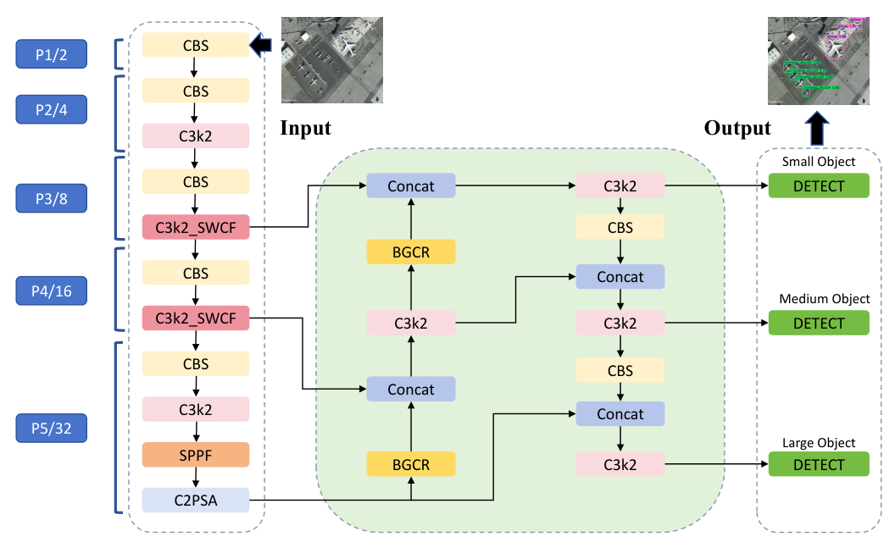

# SDF-YOLO

**Dynamic Shape-Aware and Bi-Directional Reconstruction for Small Object Detection**

Chunzhi Li, Qianliang Rong, Xiaohua Chen, and Huimeng Zheng

SDF-YOLO is a lightweight remote sensing small-object detector built on YOLO11n. It combines a **Shape-Aware Weighted Context Fusion (SWCF)** module in the backbone with a **Bi-Directional Guided Compensation Reconstruction (BGCR)** module in the neck. SWCF combines local details and shape-aware context through learnable branch weights. BGCR performs regularized frequency-domain upsampling followed by local spatial detail compensation.




## Dataset Download

The manuscript evaluates SDF-YOLO on three remote sensing benchmarks:

| Dataset | Source | Training images | Validation images | Test images |
| --- | --- | ---: | ---: | ---: |
| SIMD | [Official repository](https://github.com/ihians/simd) | 3,500 | 500 | 1,000 |
| VEDAI | [Dataset website](https://downloads.greyc.fr/vedai/) | 747 | 249 | 249 |
| AI-TOD-v2 | [Official repository](https://github.com/Chasel-Tsui/AI-TOD-v2) | 11,214 | 2,804 | 14,018 |

The image counts describe the splits reported in the manuscript. Obtain the datasets from their original sources and follow their respective terms of use.

## Dataset Structure

The analysis tool accepts horizontal bounding boxes in normalized YOLO format:

```text
class_id center_x center_y width height
```

Organize a converted dataset as follows:

```text
SIMD/
  images/
    train/
    val/
    test/
  labels/
    train/
    val/
    test/
```

Each image has a matching `.txt` label file in the parallel `labels/` directory. Background images use an empty label file. A missing label file is treated as an error so that incomplete annotations do not silently affect the statistics.

[data/SIMD.yaml](data/SIMD.yaml) provides a 15-class configuration example. Set `path` to your dataset root and verify the class-ID mapping against your annotation conversion. For VEDAI and AI-TOD-v2, supply the YAML produced by your own conversion; do not assume that independently converted datasets share a class order.

## Installation

The supporting tools require Python 3.11. 

```bash
python -m pip install -r requirements.txt
```

Run all commands from the repository root. Commands are shown on one line so they work in both Bash and PowerShell.

## Training

To train the model, run this command::

```bash
python train.py 
```

## Evaluation

To evaluate pretrained model, run:

```bash
python val.py
```

## Citation

The manuscript title and author list are recorded in [CITATION.cff](CITATION.cff). Publication details and a DOI are not assigned in this release.

```bibtex
@unpublished{li_sdf_yolo,
  title  = {Dynamic Shape-Aware and Bi-Directional Reconstruction for Small Object Detection},
  author = {Li, Chunzhi and Rong, Qianliang and Chen, Xiaohua and Zheng, Huimeng},
  note   = {Manuscript}
}
```
